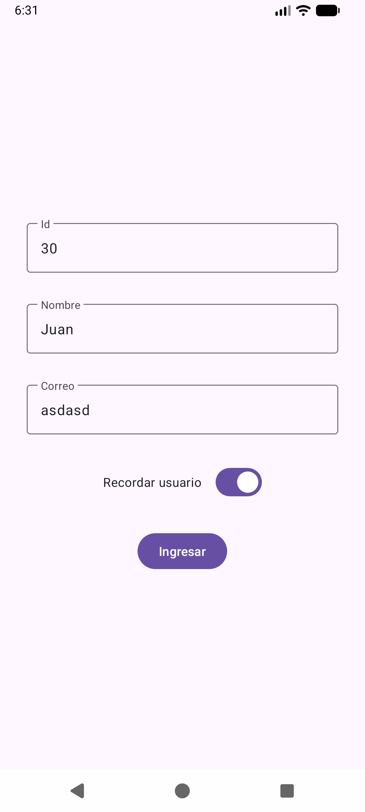
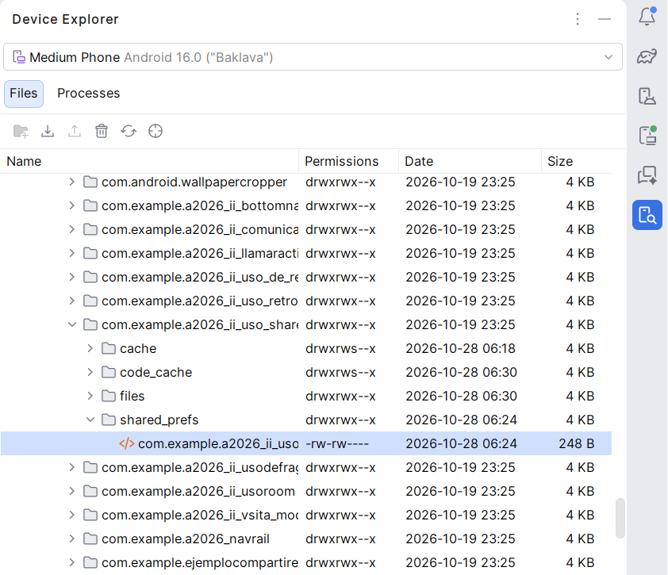

# Ejercicio. Uso de un archivo de preferencias para guardar información  

El ejercicio muestra como guardar información de configuración o preferencias.
se crea una interface que captura información de un usuario como su nombre, correo y un 
identificador, se incluye un *MaterialSwitch* para habilitar el guardado de la información 
Se emplea la herramienta *DeviceExplorer* para mostrar el archivo XML  donde se guardó la información

    

<b>Figura 1.</b> Captura de pantalla de la Activity principal

    

<b>Figura 1.</b> Captura de pantalla de la ventana DeviceExplorer que muestra el arhivo de preferencias

# Enlaces de referencias

1. [Share Preferences] (https://developer.android.com/training/data-storage/shared-preferences) Descripción para guardar datos con *SharePreferences*

